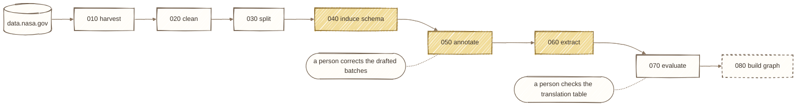
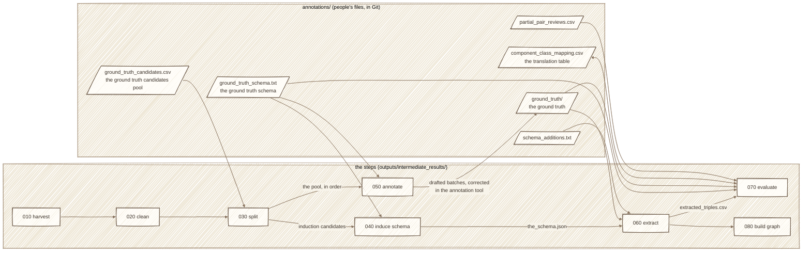
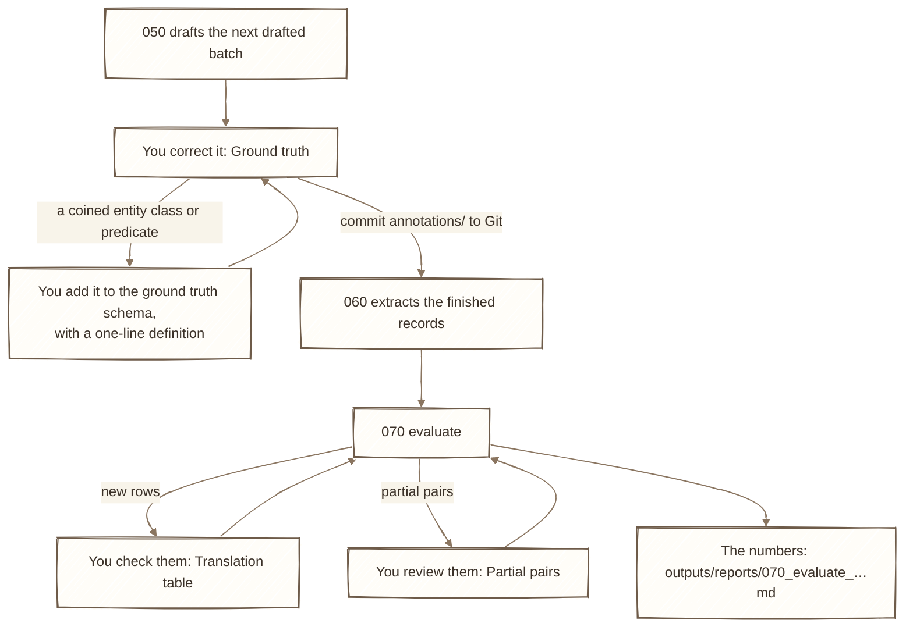
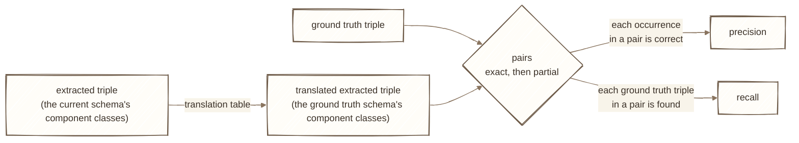
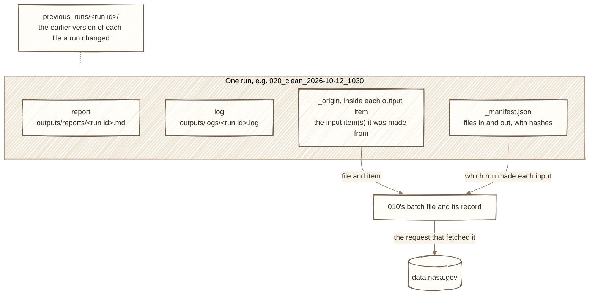

# The pipeline in pictures

The pipeline at a glance, in six diagrams. Each says what it shows in a sentence or two and links to where the details are; the details aren't repeated here. Terms are defined in [`terminology.md`](terminology.md).

## 1. The steps

Eight steps, run in order: `py run_pipeline.py` runs them all (README, *Pipeline overview*), and each also runs on its own, `py <step>/run.py`. Three of them ask a model; in two of them a person has work to do.



Yellow: the step asks a model (040 learns the induced schema, 050 drafts classed triples for the ground truth, 060 extracts). 070 asks a model only to propose new rows of the translation table. Dashed: not built yet. What each step does, reads, and writes: the table in the README's *Pipeline overview*, and each step's guide, `<step>/<step>.md`.

## 2. What each step reads

A step reads what earlier steps wrote in `outputs/intermediate_results/`, plus files people keep in `annotations/`, and writes only its own folder. One exception: 070 adds rows to two files in `annotations/` (the translation table, and the log of looks at the held-out part).



The induction candidates and the pool never share a record, so the schema is never learned from a text it is later evaluated on (README, *Splitting (step 030): two samples that never overlap*). Every step also reads `records.jsonl` (020); the arrows show it only where it's the main input. The files in `annotations/`: the table at the top of `annotations/README.md`.

## 3. The annotation loop

How the ground truth is made and used, and where a person comes in (in the annotation tool, `py helpers/annotate.py`).



Each box where you act is a view of the annotation tool; what each view does: `annotations/README.md`. What to write in the ground truth: [`annotations/guidelines.md`](../annotations/guidelines.md).

## 4. Inside evaluation

How 070 compares one record's extracted triples with its ground truth triples (in full: [`070_evaluate/metrics/pairs.md`](../070_evaluate/metrics/pairs.md)).



Each occurrence (of a translated extracted triple) pairs with at most one ground truth triple of the same record, and the other way round. Exact and partial are the two pair levels. Every number comes with its margin of error: [`070_evaluate/metrics.md`](../070_evaluate/metrics.md).

## 5. Tracing an output

What every run leaves behind, so that any output can be traced back to where it came from ([`helpers/audit.md`](../helpers/audit.md)).



`py helpers/audit.py <record id>` follows the origins back, step by step. Measured results that rest on these runs: [`findings.md`](findings.md).

## 6. The folders

```
010_harvest/ … 080_build_graph/   one folder per step: run.py (its control panel), its guide, its code
common/                           code that more than one step uses
helpers/                          tools that aren't steps: the annotation tool, audit, run comparison, models
annotations/                      what people make and keep in Git: the ground truth and its files
docs/                             terminology, findings, improvements, this page
tests/                            the tests
outputs/                          everything a run makes (not in Git): results, reports, logs, caches
run_pipeline.py                   every step, in order
```

Every file and folder, with where each is explained: the README, *What's in this repository*.
